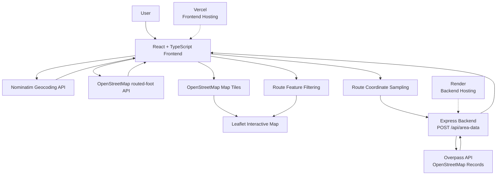
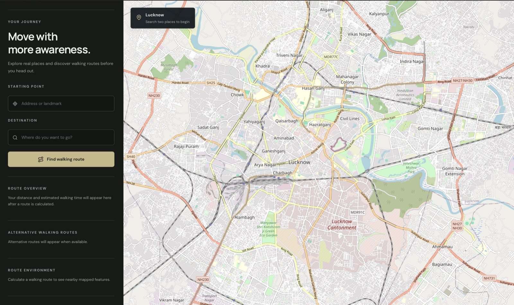
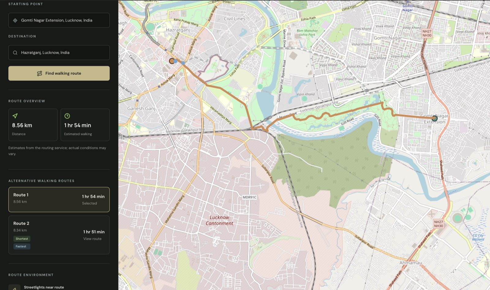
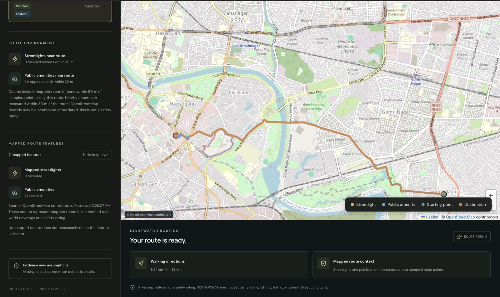

# NIGHTWATCH

### Mapping the environment around your walking route.

NIGHTWATCH is a web-based walking route exploration project that combines route planning with nearby mapped environmental features. It helps users explore recorded streetlights and public amenities along a selected walking route.

The project explores how publicly available geographic data can provide additional context when navigating unfamiliar areas.

**Live Demo:** https://night-watch-sand.vercel.app  
**Repository:** https://github.com/prajjwal0321/night-watch

---

## Features

- **Walking route planning:** Search for locations and generate walking routes.
- **Alternative routes:** Compare available walking route options.
- **Route environment:** View mapped streetlights and public amenities near a selected route.
- **Interactive map:** Explore routes and mapped features using an interactive map.
- **Feature markers:** Distinguish mapped streetlights, amenities, starting points, and destinations.
- **Responsive interface:** Supports desktop and mobile browsers.

## How It Works

NIGHTWATCH combines routing information with geographic features retrieved from OpenStreetMap.

1. A user selects a starting point and destination.
2. The application generates walking route options.
3. Route coordinates are sampled to identify nearby geographic features.
4. The backend queries OpenStreetMap data for recorded streetlights and selected public amenities.
5. The application displays the retrieved records and their proximity to the route.


## System Architecture




## Technology Stack

| Layer | Technologies |
|---|---|
| Frontend | React, TypeScript, Vite |
| Mapping | Leaflet, React Leaflet |
| Backend | Node.js, Express |
| Geographic data | OpenStreetMap, Overpass API |
| Deployment | Vercel, Render |

## Data and Methodology

NIGHTWATCH retrieves geographic records from OpenStreetMap through the Overpass API.

The current implementation queries for:

- Streetlights (`highway=street_lamp`, `man_made=street_lamp`)
- Benches (`amenity=bench`)
- Drinking water facilities (`amenity=drinking_water`)
- Public toilets (`amenity=toilets`)

The backend searches within 60 metres of sampled route points. The frontend measures nearby records within 30 metres of the route.

## Limitations

NIGHTWATCH is an exploratory mapping tool, not a safety assessment system.

- OpenStreetMap coverage may be incomplete or outdated.
- An unrecorded streetlight or amenity may still exist in reality.
- Mapped records do not establish whether a facility is operational or accessible.
- The application does not currently verify crime rates, traffic conditions, actual illumination, or real-time street conditions.

The displayed information should therefore be interpreted as mapped geographic context, not a guarantee of safety.

## Running Locally

### Prerequisites

- Node.js
- npm

### Installation

Clone the repository:

```bash
git clone https://github.com/prajjwal0321/night-watch.git
cd night-watch
```

Install dependencies:

```bash
npm install
```

### Environment Variables

Create a `.env` file in the project root:

```env
OVERPASS_API_KEY=your_overpass_api_key
```

For local development, the frontend uses the Vite development proxy configured in `vite.config.ts`.

### Start the backend

```bash
npm run start
```

### Start the frontend

In a separate terminal:

```bash
npm run dev
```

### Production build

```bash
npm run build
```

## Project Status

NIGHTWATCH is currently an operational MVP with deployed frontend and backend services.

Further development will focus on improving map rendering, geographic data coverage, route analysis, and overall reliability.

## Acknowledgements

Geographic data © [OpenStreetMap contributors](https://www.openstreetmap.org/copyright).

This project uses publicly available OpenStreetMap data through the Overpass API.

---

**NIGHTWATCH**  
*Explore the environment around your route.*

## Screenshots

### Dashboard


### Route Planning


### Route Environment
